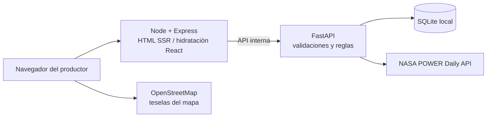

# Arquitectura del MVP

## Decisiones principales

El requerimiento final es React, Vite, Tailwind, SSR, FastAPI y SQLite. Usamos Node como una capa delgada para renderizar React y dirigir solicitudes; la lógica agrícola y los datos viven en Python.

El primer HTML contiene dashboard y parcelas obtenidos de SQLite. `hydrateRoot` agrega los eventos en el navegador. Leaflet se importa después de montar el componente: no intenta usar `window` durante SSR. El endpoint `/api/bootstrap` reúne la información inicial.

## Separación de responsabilidades

| Componente | Responsabilidad |
|---|---|
| `frontend/server.mjs` | HTML SSR, proxy a FastAPI, acceso de equipo en producción y control de origen en escrituras |
| `src/App.jsx` | Estado de parcelas, navegación, dashboard y páginas de información |
| `components/PlotForm.jsx` | Formulario y flujo guardar → consultar NASA |
| `components/Map.jsx` | Leaflet, GPS indirecto desde el formulario, punto y círculo |
| `components/Environment.jsx` | Fechas, gráfica, tabla, fuentes y faltantes |
| `components/Rotation.jsx` | Opciones, descartes, reglas y descarga del informe |
| `backend/app/main.py` | Endpoints, errores, límite del piloto y orquestación |
| `models.py` | Validaciones de tipos, rangos, fechas y campos permitidos |
| `database.py` | Transacciones SQLite y consultas parametrizadas |
| `services/nasa.py` | HTTP al proveedor, normalización, faltantes, caché y procedencia |
| `services/rotation.py` | Catálogo botánico, reglas y mensajes explicativos |
| `services/geo.py` | Área circular y límite geográfico aproximado |

## Flujo completo

1. Node consulta `GET /api/bootstrap` a FastAPI y renderiza el HTML.
2. React hidrata ese HTML. No se necesita JavaScript para que el contenido inicial exista en la respuesta.
3. El productor selecciona un punto y radio; aporta su historial y mediciones opcionales.
4. `POST /api/parcels` valida y guarda. El área se calcula en el servidor.
5. `POST /api/parcels/{id}/analyze` consulta NASA para el punto y período solicitados. Nunca toma datos de otra ubicación como sustituto.
6. Se normalizan los valores, se identifica cada faltante y se calculan los resúmenes.
7. Se guarda la última consulta de la parcela y se devuelve la parcela con sus opciones iniciales de diversificación.
8. Si falla NASA, la parcela sigue registrada y puede consultarse nuevamente.

Cambiar las coordenadas elimina la consulta asociada para evitar mostrar el clima de la ubicación anterior. Cambiar el cultivo anterior recalcula las opciones. La duración o los resultados de una cosecha no se inventan.

## Endpoints

| Método y ruta | Uso |
|---|---|
| `GET /api/health` | Estado básico sin datos privados |
| `GET /api/bootstrap` | Estado inicial para SSR |
| `GET /api/parcels` | Listar parcelas y sus datos guardados |
| `POST /api/parcels` | Crear una parcela |
| `GET /api/parcels/{id}` | Consultar una parcela |
| `PUT /api/parcels/{id}` | Editar características o ubicación |
| `DELETE /api/parcels/{id}` | Eliminar parcela y última consulta vinculada |
| `POST /api/climate` | Consultar NASA sin vincular una parcela |
| `POST /api/parcels/{id}/analyze` | Consultar y guardar datos NASA de una parcela |
| `GET /api/parcels/{id}/recommendation` | Reglas y opciones actuales |
| `GET /api/docs` | Documentación OpenAPI de desarrollo |

## SQLite

`parcels` guarda características declaradas, identificadores y fechas. `climate_snapshots` guarda la última respuesta normalizada de cada parcela, con eliminación en cascada. `nasa_cache` evita repetir una consulta idéntica durante el plazo configurado. Las claves de caché incluyen coordenadas, período y parámetros.

La primera versión usa `PRAGMA user_version = 1`. Las futuras modificaciones del esquema necesitan migraciones explícitas; no hay un ORM ni un sistema de migraciones complejo todavía. SQLite utiliza claves foráneas y WAL para el uso local de un equipo.

## Seguridad y alcance

Desarrollo en localhost, sin acceso remoto. Producción exige autenticación HTTP Basic de equipo en el servidor SSR, bajo HTTPS del alojamiento, y token interno entre Node y FastAPI. El navegador no recibe ese token. Las escrituras de otro origen se rechazan. El backend no expone sus detalles de validación privados ni las notas en mensajes de error.

No hay multiusuario, roles por agricultor, recuperación de contraseña ni autorización por propietario. Es una instalación de equipo para demostración. Antes de compartirla entre productores hay que implementar esas capacidades.

## Verificación

- Pytest: cálculo de área, series meteorológicas, faltantes, reglas de familia, validación, CRUD, persistencia, caché, fallos NASA y token interno.
- Node Test Runner: HTML SSR, fallo del backend, serialización segura y acceso protegido.
- `scripts/smoke_system.py`: servidores reales, proxy HTTP, SQLite temporal y contenido SSR con la parcela registrada.
- `--live`: consulta real a NASA a través del circuito completo. Es independiente de las pruebas reproducibles sin internet.
- La compilación valida ambos paquetes: cliente y servidor SSR.

No se ha validado agronómicamente con agricultores ni se ha completado una revisión visual interactiva en navegador en este entorno. Los puntos de producción y persistencia remota se detallan en `CLOUD_RUN.md`.
